[README (5).md](https://github.com/user-attachments/files/34775869/README.5.md)
<div align="center">



<br/>

<a href="https://github.com/astrax-gif/smart-coworking-app/actions"></a>


<br/><br/>

**A full-stack coworking portal** · interactive floor plan · live availability · admin dashboard · REST API · Postgres database

</div>

---

## How a booking travels



A customer picks a desk, the browser calls the API, the server validates the request and writes to Postgres. Staff open the admin dashboard and see every booking from every device, in real time.

---

## What's inside

<table>
<tr>
<td width="50%" valign="top">

### 🧑‍💻 Customer portal
- Interactive SVG floor plan with live availability
- Quiet / Social zone filter and morning-sun filter
- Booking form: date, time slot, drinks, seating, extras
- Instant guest Wi-Fi code and booking reference
- Space detail page with amenities and good-to-know info
- Support chat, light and dark themes, mobile-ready

</td>
<td width="50%" valign="top">

### 🛡️ Admin dashboard
- Password login with signed, expiring session tokens
- Live booking table: confirm, cancel, delete, export CSV
- Desk control: block spaces for maintenance in one click
- Power Hour: set discount and mode (auto / on / off)
- KPI strip: total, pending, confirmed, today, blocked

</td>
</tr>
<tr>
<td width="50%" valign="top">

### ⚙️ Back end API (`api/`)
- `GET  /api/availability` — booked + blocked spaces, offer settings
- `POST /api/bookings` — create a booking, returns ref + Wi-Fi code
- `POST /api/admin/login` — password in, signed token out
- `GET/PATCH/DELETE /api/admin/bookings` — manage bookings
- `GET/PUT /api/admin/blocked` — spaces out of service
- `GET/PUT /api/admin/settings` — Power Hour offer

</td>
<td width="50%" valign="top">

### 🔒 Security & reliability
- Server-side re-validation (browser is never trusted)
- Constant-time password check, rate limiting on every route
- Signed HMAC tokens, 8-hour expiry, no cookies
- Double-booking blocked in the API **and** by a unique index in Postgres
- Row Level Security on: only the service key can read or write

</td>
</tr>
</table>

---

## The double-booking guard


The first booking for a slot is accepted and saved. Any later request for the same desk, date and slot is refused with `409 Conflict` before it touches the database. The database also carries a unique partial index as a final safety net.

---

## Project layout

```
smart-coworking-app/
│
├── index.html          # Customer: floor plan + desk filter
├── space.html          # Customer: space detail + booking form
├── admin.html          # Staff: dashboard (login required)
├── styles.css          # Shared styles, light/dark themes
├── data.js             # Floor-plan builder, demo data layer
├── api.js              # Browser REST client
│
├── api/                # Back end – Vercel serverless functions
│   ├── availability.js
│   ├── bookings.js
│   └── admin/
│       ├── login.js
│       ├── bookings.js
│       ├── blocked.js
│       └── settings.js
│
├── lib/                # Shared server modules
│   ├── auth.js         # Token sign + verify, password check
│   ├── http.js         # Route wrapper, rate limiter, error handler
│   ├── store.js        # Data layer: Supabase or in-memory demo
│   ├── validate.js     # Input rules (space IDs, dates, slots, emails)
│   └── wifi.js         # Guest Wi-Fi code generator, booking ref
│
├── db/
│   └── schema.sql      # Tables, indexes, RLS — run once in Supabase
│
├── assets/             # Animated SVGs (hero, flow, clash)
│
├── tests/
│   └── api.test.js     # 4 automated tests (Node built-in runner)
│
├── scripts/
│   └── dev-server.js   # Local dev: static files + /api routes, no install needed
│
├── .github/workflows/
│   └── ci.yml          # Run tests on every push
│
├── vercel.json         # Security headers
├── .env.example        # Environment variable template
└── README.md
```

---

## Run it locally

```bash
# Node 18 or later, no npm install needed
npm run dev
# → http://localhost:3000

npm test
# → 4 tests: slots, validation, auth tokens, booking flow + clash guard
```

With no database configured it runs in **demo mode**: data lives in memory, the admin password is `admin2026`, and the Wi-Fi code generator still works.

---

## Deploy to production

### 1 · Database (Supabase)

1. Create a free project at [supabase.com](https://supabase.com).
2. Open **SQL Editor → New query**, paste `db/schema.sql` and run it.
3. In **Settings → API**, copy the **Project URL** and the **`service_role`** secret key.

### 2 · Environment variables (Vercel)

Go to **Project Settings → Environment Variables** and add:

| Variable | Where to get it |
|---|---|
| `SUPABASE_URL` | Supabase Settings → API |
| `SUPABASE_SERVICE_KEY` | Supabase Settings → API (service_role) |
| `ADMIN_PASSWORD` | Make up a long password for staff login |
| `AUTH_SECRET` | A long random string, e.g. from `openssl rand -hex 32` |

> **Never commit these values.** They are server secrets that live only in Vercel.

### 3 · Push and open

```bash
git push origin main   # Vercel redeploys automatically
```

Open `/admin.html`, sign in with your `ADMIN_PASSWORD`. Every customer booking from any device now shows up instantly.

---

## Roadmap

- [ ] Email confirmations (Resend or Postmark)
- [ ] Real guest Wi-Fi provisioning via access controller API
- [ ] Payments and invoices (Stripe)
- [ ] Multi-location and per-staff roles (Supabase Auth)
- [ ] Date picker on the floor plan

---

<div align="center">

Built by **Abdurhman Bereket** · [LinkedIn](https://www.linkedin.com/in/abdurhmanbereket/) · [abdurhmanbereket74@gmail.com](mailto:abdurhmanbereket74@gmail.com)

</div>
